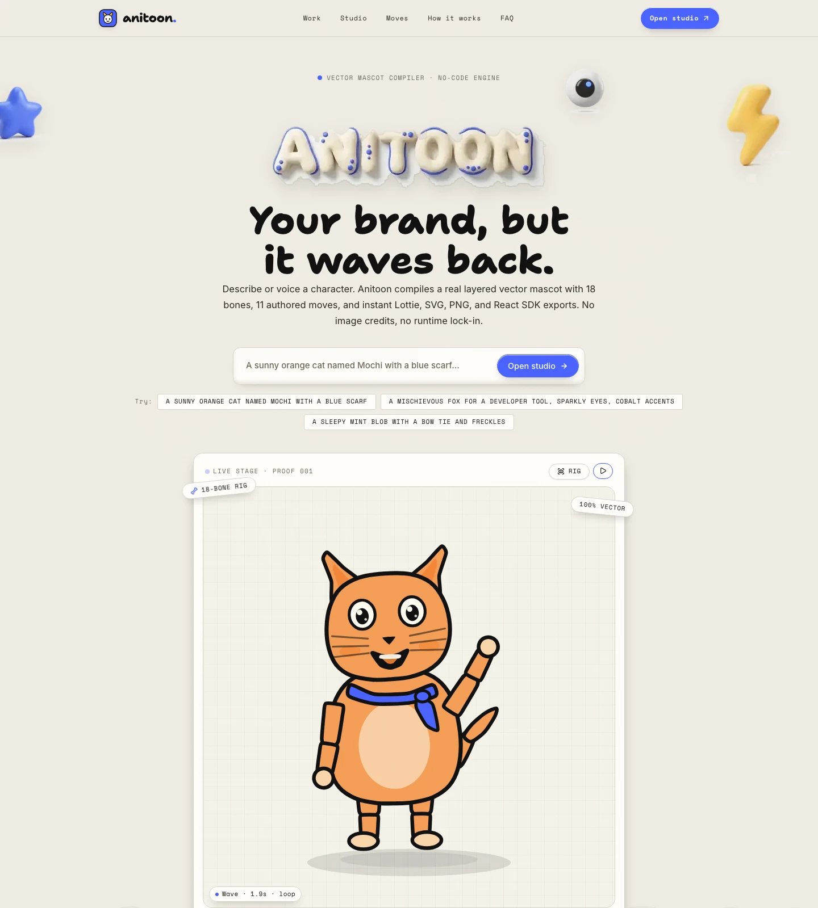

# Anitoon — Vector Mascot Compiler (No-Code)

> **WeMakeDevs × Wispr Flow Challenge — Track 2: No-Code**  
> Describe or voice a character → deterministic vector mascot with a real 18-bone rig and 11 authored moves.  
> Export Lottie JSON, layered SVG, 1024px PNG, or a drop-in React SDK.  
> Zero image credits, zero runtime dependencies, zero API costs.



---

## Highlights

- **Deterministic Rig**: Same brief, same character geometry every time. Limbs, bones, eyes, and expressions compile locally in the browser.
- **11 Authored Moves**: Idle, wave, jump, dance, nod, walk, spin, celebrate, think, laugh, and bow — bone-driven motion, baked at 30fps for export.
- **Exports That Ship**:
  - `Lottie JSON` — compact vector animation, typically ~100–200KB for a 2s move, ready for web, iOS, and Android.
  - `Layered SVG` — infinite scale, editable vector geometry.
  - `High-Res PNG` — 1024×1024 raster for Figma and slide decks.
  - `React SDK ZIP` — dependency-free `Mascot.tsx` component, types, and offline preview HTML.
- **Voice-to-Rig**: Built-in speech recognition parses natural language briefs into species, vibes, colors, and accessories.
- **100% Client-Side**: No auth, payments, cloud database, or runtime API calls. State persists in browser `localStorage`.

---

## Run Locally

```bash
# Clone the repository
git clone https://github.com/pranavk429/anitoon.git
cd anitoon

# Install dependencies
npm install

# Start development server
npm run dev
```

Open [http://localhost:3000](http://localhost:3000) in your browser.

---

## Production Build

```bash
npm run build
npm run start
```

---

## Tech Stack

- **Framework**: Next.js 16 (App Router, Turbopack)
- **Library**: React 19, TypeScript
- **Styling**: Tailwind CSS v4
- **Animation**: Lottie Web, Canvas 2D, SVG kinematics
- **Icons**: Lucide React
