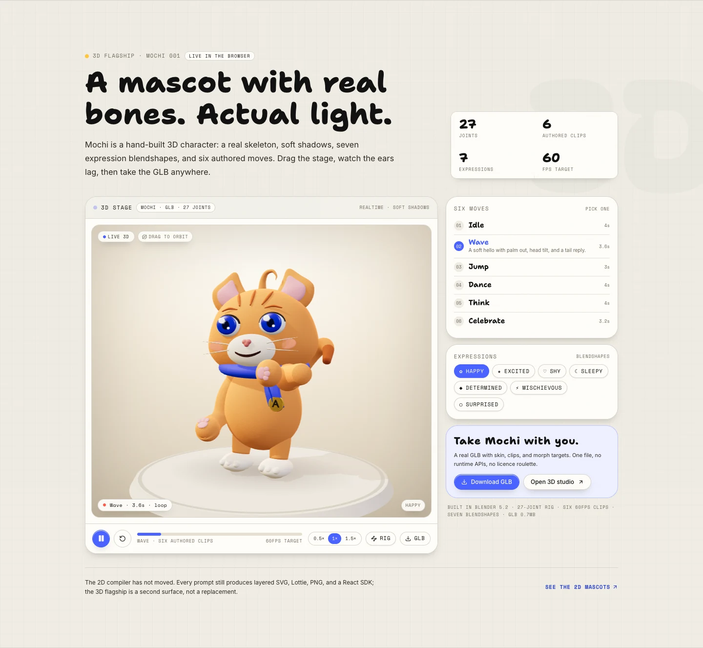

# Anitoon — Vector Mascot Compiler (No-Code)

> **WeMakeDevs × Wispr Flow Challenge — Track 2: No-Code**  
> Describe or voice a character → deterministic vector mascot with a real 18-bone rig and 11 authored moves.  
> Plus a flagship 3D stage: Mochi, a hand-built 27-joint character with six authored clips, seven expression blendshapes, soft studio light, and a real GLB export.
> Zero image credits, no runtime APIs, zero API costs.




---

## Highlights

- **Deterministic Rig**: Same brief, same character geometry every time. Limbs, bones, eyes, and expressions compile locally in the browser.
- **11 Authored Moves**: Idle, wave, jump, dance, nod, walk, spin, celebrate, think, laugh, and bow — bone-driven motion, baked at 30fps for export.
- **Exports That Ship**:
  - `Lottie JSON` — compact vector animation, typically ~100–200KB for a 2s move, ready for web, iOS, and Android.
  - `Layered SVG` — infinite scale, editable vector geometry.
  - `High-Res PNG` — 1024×1024 raster for Figma and slide decks.
  - `React SDK ZIP` — dependency-free `Mascot.tsx` component, types, and offline preview HTML.
  - `GLB` — the separate 3D flagship: 27-joint skeleton, six clips, five mouth morph targets, Meshopt-compressed to ~0.7MB.
- **Voice-to-Rig**: Built-in speech recognition parses natural language briefs into species, vibes, colors, and accessories.
- **Flagship 3D Stage**: Mochi the cat — 27-joint Blender rig, six 60fps clips, seven blendshape expressions, procedural blink and gaze, cinematic realtime lighting, camera orbit, and a Meshopt-compressed GLB (~0.7MB).
- **100% Client-Side**: No auth, payments, cloud database, or runtime API calls. State persists in browser `localStorage`. The 3D model is a local asset.

---

## Flagship 3D — Mochi

Mochi is a hand-built Blender character, not an AI base or an asset flip: 27 joints, six authored 60fps clips, seven expression performances, real mouth blendshapes, procedural blink/gaze, cinematic warm studio light, and a 0.7MB Meshopt GLB.

- Try the 3D tab in the studio after running locally: `/studio?mode=3d`.
- The landing's **3D flagship** section loads the stage lazily only when it is in view.
- The 2D compiler, layered SVG, Lottie, PNG, React SDK, and share links are unchanged.

[Read the full 3D report](THREE_D_REPORT.md) · [Expression sheet](docs/three-expressions.webp) · [Move sheet](docs/three-moves.webp) · [6s stage capture](docs/three-demo.mp4)

### Rebuilding the character

```bash
# geometry, 27-joint rig, face, six clips → public/three/mochi.glb
blender -b --python tools/blender/build_mochi.py -- --export

# Meshopt-compress for the live stage (~2.4MB → ~0.7MB)
npx gltf-transform meshopt public/three/mochi.glb /tmp/mochi.glb --level high
mv /tmp/mochi.glb public/three/mochi.glb
```

The headless build is deterministic. The mesh/rig live in `tools/blender/build_mochi.py`, primitives in `mochi_lib.py`, and clips in `mochi_anim.py`. No Mixamo clips or third-party character assets are used.

---

## Run Locally

```bash
# Clone the repository
git clone https://github.com/pranavk429/anitoon.git
cd anitoon

# Install dependencies
npm install

# Start development server
npm run dev
```

Open [http://localhost:3000](http://localhost:3000) in your browser.

---

## Production Build

```bash
npm run build
npm run start
```

---

## Tech Stack

- **Framework**: Next.js 16 (App Router, Turbopack)
- **Library**: React 19, TypeScript
- **Styling**: Tailwind CSS v4
- **Animation**: Lottie Web, Canvas 2D, SVG kinematics
- **3D**: Three.js, React Three Fiber, Drei, Blender 5.2 (headless Python build)
- **Icons**: Lucide React
