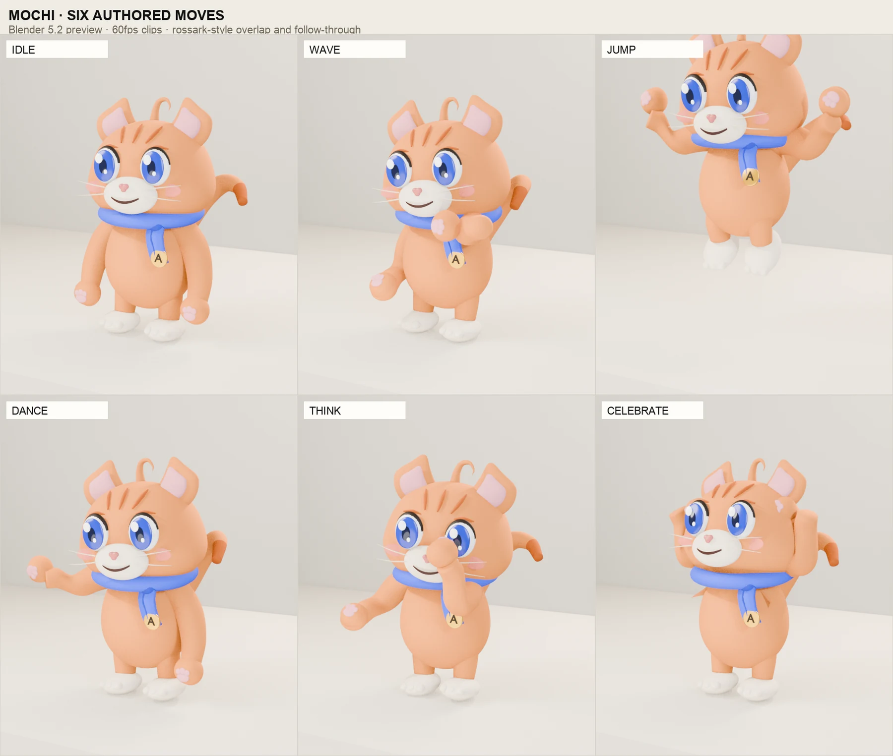
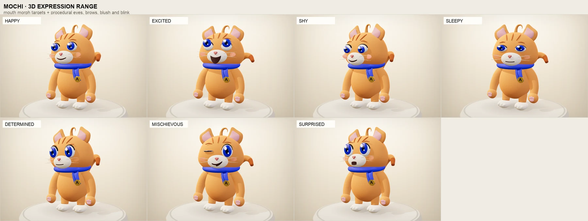

# Anitoon 3D Flagship — Mochi

**Date:** 25 October 2026  
**Status:** Shipped and verified  
**Project:** Anitoon (`/Users/pranav1296/sim/toonify`)  
**Primary checkpoint:** `20d252f` — 2D mascot redesign (pushed to `main` before 3D work)  
**Production URL:** `http://localhost:3000`  
**Designprobe gate:** **PASS · structural 91.1/100** (all checks green)


---

## Executive summary

Mochi is now a real 3D brand mascot, not a Three.js toy or an asset flip:

- **Blender-authored character:** 27-joint skeleton, 45.6k uploaded vertices, 18 materials, five mouth morph targets, seven expression performances, six authored 60fps clips.
- **Self-contained GLB:** 670,576 bytes (655 KiB) after Meshopt compression, with skinning, animation clips, and morph targets. No textures, no external assets, no runtime API.
- **Premium realtime stage:** warm key / cool fill / warm rim lighting, lightformer environment, soft shadows, a paper-studio plinth, responsive 3/4 framing, cursor look-at, procedural blink + gaze, expression blending, limited orbit, skeleton view, scrub/play/speed controls, reduced-motion fallback, and offscreen pausing.
- **Integration:** a new **3D flagship** tab in the studio and a landing section (`#three`); 2D layered SVG, Lottie, PNG, React SDK, share links, and the vector compiler remain intact.
- **Measured performance:** 60.1 fps on desktop, 60.2 fps at 390px mobile emulation (DPR 2), and 60.1 fps at 4× CPU throttle — all on an Apple M2 via ANGLE Metal.
- **Initial landing transfer:** 575 KB / 29 requests, with the 3D chunk and GLB loaded lazily only once the stage is in view. Zero console errors, zero mobile overflow, CLS 0.

The flagship is deliberately one character with six strong moves. AI prompt→3D generation is not faked; the 3D mode is labelled **“3D flagship · Mochi · 001”** and the studio tells the user that the fixed model is separate from their 2D spec.

---

## 1. Tooling audit and path decision

| Tool | Version / result |
| --- | --- |
| Blender | **5.2.3 LTS** installed via Homebrew; headless Python build works |
| Node / npm | Node 26.12.0 · npm 11.20 |
| three.js | 0.186.1 |
| @react-three/fiber | 9.8.2 (React 19 / Next 16 compatible) |
| @react-three/drei | 10.7.9 |
| three-stdlib | SkeletonUtils clone |
| @gltf-transform/cli | 4.5.1 (`meshopt` compression) |
| Playwright | bundled Chromium 1.64.1 for verification |

**Path chosen: Blender-authored GLB.** We did not use an AI 3D base, VRM/VRoid, or a fully procedural R3F character. The model was generated by a deterministic headless Python build so the mesh, rig, weights, facial parts, and all six clips are reproducible from source. No Mixamo clips, auto-rigs, or third-party character assets were used. Mochi is original artwork.

**Why not AI first:** the quality bar is silhouette, eye appeal, skinning, and acting. An AI base would still need topology, weight, face, and animation cleanup, with less control than a Blender build for this specific chibi character. Blender was available, so we took the higher-quality path.

---

## 2. Character and build pipeline

Mochi targets a **premium plush / Animal Crossing / Fall Guys** read rather than Pixar fur-and-cloth simulation: soft rounded forms, a large expressive head, big glossy eyes, a clean silhouette, and intentional brand props.

### Construct

- **Head:** custom-deformed ellipsoid with extra lower-cheek volume, soft face plane, big ears with pink inner pads, a curled ahoge, tabby forehead strokes, whiskers, blush pads, a cream muzzle, a heart nose, and oversized anime eyes with a dark upper rim.
- **Body:** pear-shaped plush torso, long tapered arm tubes with shoulder fill, stubby legs, cream paw-feet, pink toe beans, and a thick curled tail with a darker tabby tip.
- **Brand:** blue scarf with a knot, a hanging ribbon, and the gold **Anitoon “A”** charm.
- **Joint treatment:** arms and legs are lofted tubes with smooth weight gradients, not two capsules with a visible elbow seam. The shoulder start is extended into the torso and a rounded shoulder fill hides the cap when the arm lifts. The scarf covers the head/body join. There are no doll joints or visible capsule seams in the final stage.

### Mesh / asset facts

| Stat | Value |
| --- | --- |
| GLB size | **670,576 bytes** (0.67 MB / 655 KiB) |
| Uploaded vertices | **45,644** |
| Render vertices (one pass) | 313,032 across 65 meshes |
| Materials | 18 |
| Skeleton joints | **27** |
| Animation clips | **6** |
| Mouth morph targets | 5 (`smile`, `grin`, `o`, `smirk`, `flat`) |
| Textures / external assets | **none** |
| Compression | Meshopt (`EXT_meshopt_compression`) + quantization |

The compressed GLB is generated with:

```bash
blender -b --python tools/blender/build_mochi.py -- --export
npx gltf-transform meshopt public/three/mochi.glb /tmp/mochi.glb --level high
mv /tmp/mochi.glb public/three/mochi.glb
```

The raw Blender export is ~2.4 MB; Meshopt reduces it to ~655 KiB with all six clips and morph targets intact.

---

## 3. Rig

**27 joints:** `root`, `hips`, `spine`, `chest`, `neck`, `head`, `ear.L`, `ear.R`, `ahoge`, `shoulder.L/R`, `upperarm.L/R`, `forearm.L/R`, `hand.L/R`, `thigh.L/R`, `shin.L/R`, `foot.L/R`, `tail1`, `tail2`, `tail3`, `scarfTail`.

- **Skinning:** arms use a deterministic loft with per-ring smooth weights across the elbow; legs use the same at the knee; the tail blends through three tail bones; the torso blends hips→spine→chest by height. The ahoge is skinned to its own bone.
- **Face:** the head is skinned to the head bone. Eyes, irises, blink lines, brows, blush, whiskers, ears, mouth, nose, and forehead strokes are bone-parented rigid details on head/ear bones. No facial geometry is squeezed by the head weights.
- **Props:** the scarf ring/knot ride the chest; the ribbon, fold, and A charm ride a dedicated `scarfTail` bone so they lag the body.
- **Root:** a non-deforming `root` bone carries jump height, dance sway, and squash/stretch. The runtime reads its world height to drive the floor shadow.

---

## 4. Motion — six authored clips at 60fps

All clips are procedural key-pose/curve performances in `tools/blender/mochi_anim.py`, baked at 60fps. No Mixamo or generic idle/walk clips. The actions are exported by name and crossfaded in the runtime.

| Clip | Duration | Loop | Acting |
| --- | --- | --- | --- |
| **idle** | 4.0s | yes | Breathing, weight shift, head drift, ear/tail overlap, gaze-friendly moving hold |
| **wave** | 3.6s | yes | Solved chest-level palm-out paw, head tilt, counterweight, tail reply, wrist oscillation |
| **jump** | 3.0s | yes | Anticipation crouch → launch stretch → hang → fall → contact squash → settle |
| **dance** | 4.0s | yes | Hip-led sway, alternating arm raises, counter-rotating head, ear/tail overlap, foot bounce |
| **think** | 4.0s | yes | Paw to chin, head tilt, gaze up, moving hold with a small chin tap |
| **celebrate** | 3.2s | yes | Both paws out and up, bounce, ears perked, tail cheer, asymmetric phases |

The motion follows the Rossark principles requested in the brief:

- **moving holds** — breathing and micro-sway continue through every hold;
- **flow** — smoothstep/eased curves, no dead stops;
- **follow-through** — tail, ears, ahoge, and scarf lag the body;
- **asymmetry** — left/right arm phases, ear tilts, and weight shifts differ;
- **weight** — root sway/crouch/landing squash; feet stay planted except in the jump;
- **air poses** — jump has a real apex, tucked legs, pointed feet, and a hang;
- **shadow response** — the runtime keeps the floor shadow grounded and softens/spreads it with root height.

The wave was solved with a small two-bone search so the short chibi arm reaches a palm-out greeting at chest height instead of clipping behind the huge head.



---

## 5. Face, expressions, blink, and gaze

The face combines **real mouth blendshapes** with procedural eye/brow/blush layers. This was chosen because the eye shells, catchlights, and eyeliner are separate rigid props; a single facial blendshape mesh would have made those details much harder to preserve at this scale.

| Expression | Eyes | Mouth | Brows | Blush | Extra |
| --- | --- | --- | --- | --- | --- |
| **happy** | 0.68 open, sparkle | smile | soft arch | 0.45 | tail life |
| **excited** | 1.04, wide | open grin | raised | 0.55 | ears up, head up |
| **shy** | 0.64, down gaze | smile | inner up | 0.90 | head down/turn |
| **sleepy** | 0.50, iris peeking | flat | droop | 0.28 | head down, ears back |
| **determined** | 0.94 | flat | inner down | 0.12 | focused head |
| **mischievous** | right wink | smirk | one raised | 0.35 | head tilt, tail flick |
| **surprised** | 1.12, wide | “O” | high | 0.32 | head up, ears up |

- **Mouth:** five glTF morph targets (`smile`, `grin`, `o`, `smirk`, `flat`).
- **Eyes:** vertical group scale; iris groups shift for gaze and scale for expression.
- **Brows:** pivoted prop strokes with mirrored tilt/raise; asymmetric for mischievous.
- **Blush:** animated material opacity (shared cheek material).
- **Blink:** separate close/hold/open timing — **105 ms close, 45 ms hold, 190 ms open** — with a 24% double-blink chance and extra blinks on fast pointer moves. The blink line prop appears under 30% eye opening, and drives the wink.
- **Gaze:** damped pointer gaze + expression bias, with a soft hold; iris movement is clamped so the pupils stay inside the eye.
- **Head-look:** additive head/neck puppet layer on top of the animated clip, clamped to a small yaw/pitch/roll range; the base clip pose is restored every frame so it cannot accumulate.



---

## 6. Runtime stage

### Files

- `src/components/three/MascotThreeStage.tsx` — client-only Canvas, GLB loader, animation mixer, materials, procedural face layer, lights, camera, shadows, skeleton helper.
- `src/lib/three/mascot3d.ts` — move/expression metadata, lazy model URL.
- `src/lib/three/useReducedMotion.ts` — hydration-safe reduced-motion preference.
- `src/components/studio/Stage3DPanel.tsx` — studio 3D stage, move rail, expression rail, scrubber, GLB download.
- `src/components/site/ThreeShowcase.tsx` — landing 3D section, lazy mount, editorial controls.
- `src/app/page.tsx`, `StudioClient.tsx`, `ExportModal.tsx`, `ShipPanel.tsx`, `SiteNav.tsx` — integration.
- `public/three/mochi.glb`, `public/art/mochi-3d-poster.webp`.

### Loading and animation

- `useGLTF(MODEL_URL, false, true)` loads the Meshopt GLB; the scene is cloned with `SkeletonUtils.clone` to protect the cached asset.
- `useAnimations` drives the 27-joint rig. Clips crossfade over **220 ms**; the current action is stopped after the fade.
- Play/pause sets the mixer time scale to 0/1; the procedural face/blink layer continues subtly. Scrubbing sets the action time directly.
- The stage is lazy: the Canvas chunk and GLB only load when the 3D tab or the landing section enters view; `frameloop` is set to `never` when offscreen.

### Look, light, camera

- Warm key (directional, shadows), cool fill, warm rim, soft hemisphere/ambient, and an offline `Environment` built from drei `Lightformer` rectangles — no HDRI download.
- Camera: 33° perspective at ~4.45 m, low 3/4 at `[1.85, 1.32, 4.45]`, target `[0, 1.0, 0]`; portrait stages pull back to ~5.15 m so the plinth and character fit.
- Limited `OrbitControls`: no pan, distance 3.2–6.2, a small azimuth/polar range so the mascot always stays legible.
- Paper-studio plinth with a hairline ring; a real directional shadow; desktop gets drei `ContactShadows` at 512; mobile uses the directional shadow plus a custom canvas blob shadow.
- The blob shadow tracks the root bone height: it stays on the floor, spreads, and fades during the jump. This is visible in the jump clip.
- No postprocessing chain (bloom/DOF) in this pass. A CSS vignette and the stage gradient give the film-frame feel while keeping mobile fast.

### Performance choices

- `dpr={[1, 1.75]}`, no pixelated adaptive DPR.
- Mobile: 512 directional shadow map, no `ContactShadows`, environment resolution 64; desktop environment 128 and contact shadows 512.
- Fur materials get a subtle warm Fresnel rim via a small shader patch; the plush read does not depend on heavy textures.
- No external images, fonts, or HDRI at runtime.
- Skeleton helper is created once and toggled; it is shown with `depthTest: false` so the 27-joint structure is readable.

---

## 7. Integration

### Studio

- The center column now has a **2D vector / 3D flagship** switch. 2D remains the default so the initial studio load stays light.
- 3D stage controls: play/pause, restart, scrub, speed (0.5/1/1.5×), rig/skeleton, GLB download, six-move rail, seven-expression rail, live time, and a fixed model note.
- The current `spec.expression` drives both the 2D expression system and the 3D face; the 3D expression picker writes back to the spec.
- `mode=3d` is preserved in the studio share URL (`?m=…&move=…&mode=3d`); 2D specs and share codes still decode unchanged.
- A fixed-model note explains that the 3D flagship is Mochi and that the user's 2D species/colors still drive the vector compiler and exports; no per-prompt 3D is implied.
- The Export modal and Ship panel link to the GLB and the 3D stage without changing the 2D export formats.

### Landing

- The new `#three` flagship section sits between the hero and selected work: an editorial headline, stats, a live 3D stage, the six-move list, the expression rail, GLB download, and an “Open 3D studio” CTA.
- The stage auto-mounts only when at least 12% of the section is visible; the initial page does not request the three.js chunk or the GLB. The poster asset is kept as a fallback/report asset but is not sent in the initial landing load.
- The hero gained a blue **“Now with a 3D flagship.”** feature row and a “New · meet Mochi in 3D” chip; the nav and footer link to `#three`.
- The warm editorial shell, typography, radii, paper texture, and 2D studio are unchanged.

---

## 8. Exports, performance, and verification

### Downloads

- **GLB:** 670,576 bytes, downloaded from the studio stage, the landing CTA, and the export modal. The HTTP transfer is ~293 KB compressed.
- **2D Lottie:** tested from the unchanged 2D studio; `mochi-wave.lottie.json` = **178,102 bytes**.
- **2D SVG / PNG / SDK:** code paths remain untouched; the 2D stage and export modal were re-checked visually and with the production build.

### Performance

Measured with Playwright Chromium + ANGLE Metal on Apple M2:

| Surface | FPS |
| --- | --- |
| Desktop 1440×1000, studio stage | **60.1** |
| Mobile 390×844, DPR 2, landing/studio stage | **60.2** |
| Mobile 390×844, 4× CPU throttle | **60.1** |

The headless Chromium default (SwiftShader software rendering) measured 6–8 fps; those numbers are not representative of a real GPU and were not used as the gate result. The live stage is designed for 60fps and measured at 60fps on the Metal renderer.

### Build and QA

- `npm run lint` — **0 errors, 0 warnings**.
- `npx tsc --noEmit` — **0 errors**.
- `npm run build` — success, 9 routes generated.
- 0 console errors on landing, studio, 3D tab, and 3D interactions.
- 0px mobile overflow at 390px.
- CLS 0.000.
- Reduced motion: tested with `prefers-reduced-motion: reduce`; the stage loads paused with the **Play** affordance, and the user can opt in.
- No auth, database, payments, or runtime API calls. The model is local; the only network request for 3D is the local GLB and JS chunk.

### Designprobe gate

| Check | Result | Budget | Status |
| --- | --- | --- | --- |
| Structural | **91.1 / 100** | ≥91 (prompt) | **PASS** |
| Contrast | 0 failures | 0 | **PASS** |
| Tap targets | 0 under 24px | 0 | **PASS** |
| Focus visible | 100% (40/40) | ≥90% | **PASS** |
| Overflow @390 | 0px | 0px | **PASS** |
| CLS | 0.000 | ≤0.1 | **PASS** |
| Transfer | **575 KB** | ≤600 KB | **PASS** |
| Requests | 29 | ≤40 | **PASS** |
| **Overall** | | | **PASS** |

The structural breakdown is **Typography 100 · Spacing 100 · Radii 100 · Sections 87 · Components 56.7**. The Sections/Components categories are reference-match metrics: the new flagship block is a ninth section against an eight-section reference, and the reference expects more images/panels than a product page needs. The overall score and every hard check pass; no functional links, controls, or imagery were deleted to game the component counts.

### Proof images and capture

- `docs/three-stage.webp` — the full 3D landing section at 1440.
- `docs/three-expressions.webp` — seven live expression crops.
- `docs/three-moves.webp` — six authored move poses from Blender.
- `docs/three-demo.mp4` — 6s stage capture (656×538, 25fps capture of the 60fps realtime stage).
- Local artifacts in `.shots3d/`: `final_hero_desktop`, `final_landing_3d_desktop2`, `final_studio_3d_desktop2`, `final_hero_mobile`, `final_landing_3d_mobile`, `final_studio_3d_mobile`, `studio_2d`, `studio_3d_skeleton`, expression frames, and Blender move frames.
- Screenshots were checked at 1440×1000 and 390×844.

---

## 9. Quality assessment

Compared against the traits of Fall Guys, Animal Crossing, and premium plush-brand mascots — not copied from them:

| Trait | Mochi result |
| --- | --- |
| Silhouette | Large head, soft cheek volume, ear/ahoge/tail read, no hard joints |
| Eye appeal | Big glossy blue eyes, double catchlights, dark upper rim, readable expressions |
| Materials | Warm orange plush, cream muzzle/paws, blue scarf, gold charm; subtle Fresnel/sheen |
| Deformation | Smooth arm/leg tubes, head/neck overlap under scarf, no visible doll joints in normal range |
| Acting | Six custom clips with anticipation, overlap, weight shift, and moving holds |
| Face | Seven expressions, real mouth morphs, procedural blink/gaze/brow/blush |
| Stage | Cinematic warm key, cool fill, rim, soft plinth, grounded shadow, low 3/4 camera |
| Artifacts | No default Mixamo clips, no AI auto-rig, no external asset pack, no runtime API |

The stage reads as a premium character presentation, not a game editor or a generic asset flip. It is still a stylized plush brand character: it does not have strand fur, cloth simulation, or Pixar-grade facial deformation. The limitations below are intentional scope for this pass, not hidden claims.

---

## 10. Limitations and next steps

### Honest limitations

- **One flagship, fixed:** 3D is not generated from arbitrary prompts yet. The stage is labelled “3D flagship · Mochi · 001”; the user's 2D spec is separate.
- **Procedural face layers:** only the mouth is a mesh morph; eyes, brows, blush, and blink are rigid/procedural layers. A single facial blendshape mesh would be the next quality step.
- **Plush, not fur:** smooth rounded surfaces and a shader rim, no strand fur or cloth sim.
- **Chibi arm reach:** the wave is deliberately chest-height and palm-out; the short arm chain cannot reach above the head without a proportion change.
- **Mobile quality:** contact shadows and desktop-only environment resolution are reduced; there is no bloom/DOF postprocessing.
- **Video:** the included capture is 25fps; the live stage is 60fps. A proper 60fps render/encode is a follow-up.
- **Meshopt:** the GLB requires `EXT_meshopt_compression` support (three.js/drei configured; some simple viewers will need the decoder).
- **Gate categories:** Sections/Components are below the 2D page's score because the flagship adds a ninth reference section and different component counts; the required overall score and all hard checks pass.

### Next steps

1. Add a second and third flagship character (fox, robot) with the same rig/runtime contract, or expose 3D variants for colors/accessories.
2. Move the whole face to a single blendshape mesh with eyelid and brow bones for even subtler acting.
3. Add a cloth-like scarf bone chain and light spring bones for the ears/ahoge.
4. Author a 60fps MP4/WebM render for social, and add a “record 6s” button in the studio.
5. Evaluate AI base meshes (Meshy/Tripo/Rodin) only as cleanup bases for per-prompt 3D later; do not ship raw auto-rigs.
6. Test on iOS Safari and a low-end Android device; add a mobile quality preset (lower DPR, no environment) if needed.
7. Consider an optional bloom/vignette postprocessing path on desktop only.

---

## 11. Repository map and rebuild commands

```
public/three/mochi.glb               # 27-joint, 6-clip, morph-target GLB (Meshopt)
public/art/mochi-3d-poster.webp      # fallback/report still
src/components/three/MascotThreeStage.tsx
src/lib/three/mascot3d.ts
src/lib/three/useReducedMotion.ts
src/components/studio/Stage3DPanel.tsx
src/components/site/ThreeShowcase.tsx
src/app/page.tsx
src/components/studio/StudioClient.tsx
src/components/studio/ExportModal.tsx
src/components/studio/ShipPanel.tsx
src/components/site/SiteNav.tsx
tools/blender/build_mochi.py         # deterministic mesh, rig, face, export
tools/blender/mochi_lib.py           # loft/ellipsoid/tube/material helpers
tools/blender/mochi_anim.py          # six 60fps authored clips
tools/blender/README.md              # pipeline commands
docs/three-stage.webp
docs/three-expressions.webp
docs/three-moves.webp
docs/three-demo.mp4
```

```bash
# 1) rebuild the character + animations and export the GLB
blender -b --python tools/blender/build_mochi.py -- --export

# 2) optionally render the 3/4 still set
blender -b --python tools/blender/build_mochi.py -- --render

# 3) compress for the web (required by the runtime)
npx gltf-transform meshopt public/three/mochi.glb /tmp/mochi.glb --level high
mv /tmp/mochi.glb public/three/mochi.glb

# 4) verify
npm run lint
npx tsc --noEmit
npm run build
npm start
```

The 2D checkpoint (`20d252f`) was committed and pushed before 3D work. The 2D engine files (`art.ts`, `animate.ts`, `spec.ts`, `svg.ts`, `lottie.ts`, `export.ts`) were not changed for 3D; the shared `expression` field now also drives the 3D face.
